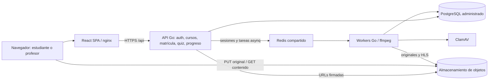
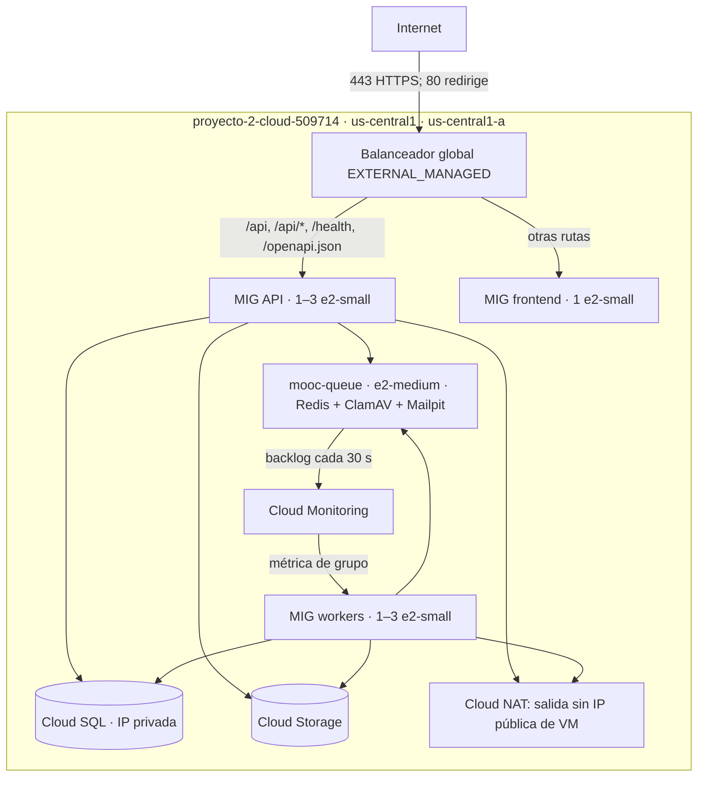

# Entrega 3 — Arquitectura elástica IaaS

Estado al 2026-10-29: configuración implementada y validación local en curso. **El despliegue elástico todavía no se ha aplicado ni medido en GCP.** Este documento distingue la configuración prevista de las evidencias cloud pendientes. No se considera cumplido el despliegue hasta completar [verificación cloud](operacion.md).

## Componentes

La API conserva el monolito modular. Redis aloja sesiones revocables y la cola `media`; los workers escanean y transcodifican fuera del ciclo HTTP. PostgreSQL contiene cursos, inscripciones, intentos, notas y progreso. Cloud Storage conserva originales, HLS y objetos públicos; el disco local del worker es temporal y se limpia con `defer`.

## Despliegue configurado

Fuentes: [componentes.mmd](diagramas/componentes.mmd), [despliegue.mmd](diagramas/despliegue.mmd). Los diagramas Markdown se renderizan en GitHub; no requieren imágenes generadas a mano. Confirmar nombres y tamaños con outputs y `gcloud describe` tras desplegar.

## Plantillas e inicialización

Las plantillas definen SO, CPU/RAM mediante el tipo de máquina, discos, identidad y metadatos por rol. [variables.tf](../../scripts/IaC/variables.tf) es la fuente de valores predeterminados y [compute.tf](../../scripts/IaC/compute.tf) de la configuración efectiva. Los tres contenedores comparten una etiqueta inmutable de Artifact Registry, identificable por commit. **Las imágenes existentes `652591e65fc2` no contienen las nuevas pantallas de esta revisión**: publicar una versión nueva requiere autorización explícita.

`startup.sh` instala Docker, obtiene secretos de Secret Manager, espera las dependencias, descarga la imagen e inicia el rol. Las migraciones se serializan con `pg_advisory_lock`. Registrar `mooc/status` y `mooc/ready-uptime-sec`: la disponibilidad del proceso se verifica antes de instalar Ops Agent. Probar también un reinicio de cada rol para comprobar que no duplica procesos.

El frontend se sirve por nginx en 3000; API y SPA comparten origen detrás del balanceador. La SPA utiliza `Authorization: Bearer`, con token en `localStorage`; no usa cookies de sesión. Cerrar sesión revoca el token en Redis. Las cargas directas y HLS usan CORS de los buckets. `localStorage` hace relevante prevenir XSS; no se inserta HTML arbitrario de los recursos.

## Escalamiento y salud

| Parámetro | API | Workers |
|---|---|---|
| Grupo | `mooc-api-mig` | `mooc-worker-mig` |
| Límites | 1–3 VMs | 1–3 VMs |
| Señal | CPU media | `custom.googleapis.com/mooc/queue/backlog` |
| Objetivo | 0,6 | 4 trabajos por VM |
| Inicialización | 180 s configurados | 180 s configurados |
| Reducción | Estabilización predeterminada de GCP; registrar comportamiento real | A lo sumo 1 retiro por ventana de 600 s, más controles de GCP |
| Autohealing | TCP 8080 | HTTP 9101 `/metrics` |

La CPU refleja el costo de bcrypt y serialización de la API. Para workers se usa **pendientes + activos**, para no interpretar una cola sin pendientes como inactividad cuando todavía hay trabajos ejecutándose. Se publica una sola serie desde la VM de cola, cada 30 segundos, `resource.type=global`, etiqueta `queue=media`; `single_instance_assignment=4`. No se cambia ninguna señal ni el tipo de balanceador.

Al llegar a 3 VMs el grupo no crece más: la API puede acumular latencia/errores y la cola puede seguir creciendo. El máximo configurado no es una capacidad medida.

El LB verifica HTTP `/health` en 8080 cada 10 s, timeout 5 s, 2 éxitos para saludable y 3 fallos para no saludable. `/health` comprueba PostgreSQL y Redis. Autohealing TCP es deliberadamente menos estricto: una caída compartida de Redis no se resuelve recreando todas las APIs. El frontend se verifica por HTTP `/` en 3000. Los workers solo tienen autohealing, no reciben tráfico del balanceador.

El LB distribuye por utilización, `max_utilization=0.8`, sin afinidad configurada. Cada respuesta API incluye `X-Served-By`; probar dos instancias saludables y excluir una no saludable. **Excluir un destino del LB y reemplazar una VM por autohealing son eventos distintos.**

## Estado, integridad y retiro

Sesiones en Redis, datos en PostgreSQL y archivos en GCS permiten alternar réplicas. El pool presupuestado es 3 API × 5 + 3 workers × 2 + 3 reservadas = 24 de 25 conexiones. Terraform valida esa combinación. El despliegue gradual puede crear una VM adicional; medir conexiones durante actualizaciones y revisar el margen antes de actualizar a máxima capacidad.

`shutdown.sh` ejecuta `docker stop`. La API dispone de 25 s para solicitudes en curso y el LB tiene drenaje de conexiones. Asynq recibe SIGTERM y dispone de 60 s; los trabajos que no finalicen deben recuperarse por su mecanismo de reintentos. Esta capacidad **requiere evidencia real**, especialmente con ffmpeg activo. Concurrencia: 4 tareas por worker, entre 4 y 12 al escalar. Guardar logs por ID de trabajo/recurso, no solo contar instancias.

Controles a verificar: sesión entre réplicas, intento duplicado sin doble calificación, progreso consistente, archivos accesibles desde cualquier API autorizada, datos conservados al reemplazar API y trabajos reconciliados después del retiro de workers.

## Seguridad y limitaciones

VMs sin IP pública; SSH por IAP; firewall por rol; Cloud SQL por IP privada; una identidad de servicio por rol y permisos de Secret Manager/GCS limitados. IAM autoriza acceso a servicios cloud; la aplicación se autentica a PostgreSQL con usuario y contraseña de Secret Manager: son mecanismos distintos.

Persisten puntos únicos de falla: una zona, VM única de Redis/ClamAV y Cloud SQL sin HA. HLS y objetos públicos tienen lectura anónima; conocer una URL permite acceder fuera de la API. La autenticación de autoría protege edición, pero hay compromisos previos que deben tratarse en [deuda técnica](deuda-tecnica.md).

Costos y consumo: [costos.md](costos.md). Operación, reconstrucción y evidencia: [operacion.md](operacion.md). Flujos: [frontend.md](frontend.md). Comparación experimental: [informe](../../capacity-planning/pruebas_de_carga_entrega3.md).
